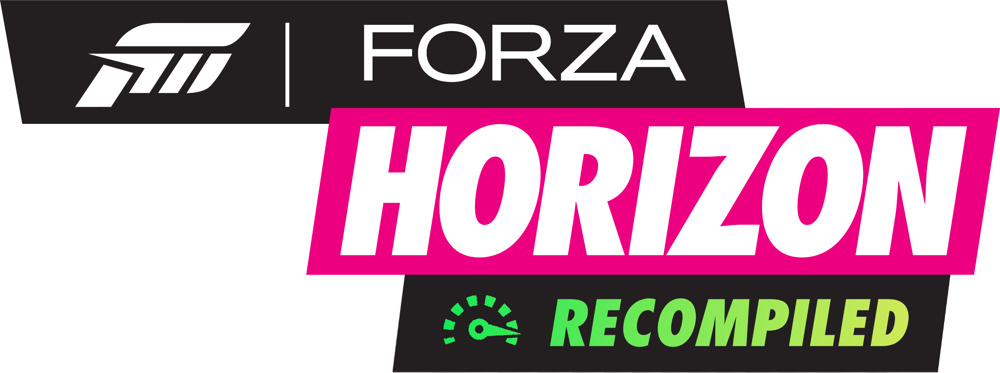

<p align="center">
  
</p>

# Forza Horizon — Xbox 360 recompilation (ReXGlue)

A native-Windows recompilation of **Forza Horizon** (2012, Xbox 360) built on
the [ReXGlue](https://github.com/danny199012) runtime: the game's PowerPC code
is statically recompiled to x86-64 ahead of time (XenonRecomp-style) and runs
on a lean reimplementation of the Xbox 360 kernel (xboxkrnl/XAM) with a Xenos
GPU emulation plugin. No CPU emulation at runtime — the game runs as native
code.

> **This repository contains no game content.** No game assets, no game
> executables, no dumps. You must own the game and supply your own dump; the
> build pipeline generates everything from your copy. See *Building* below.

## Status

What works (tested on the dev machine, Windows 11, NVIDIA + iGPU hosts):

- Boots to title, menu flow, world load
- **Save data loads and writes** (profile persistence verified)
- **Races run end to end** (multiple first-race sessions completed)
- Open-world driving with audio

Known issues (see [docs/DEVLOG.md](docs/DEVLOG.md) for the gory details):

- **HUD elements flicker** (minimap, speedometer occasionally blink) —
  GPU plugin resolve-path issue, logs show
  `PM4_DRAW_INDX_2 ... Failed in backend` / `Resolve region is empty`.
- **Collision is unreliable** — car/world collision can misbehave.
- **First save-load can sit on the loading screen** — the streaming queue
  drains slowly on this runtime; give it a minute or restart once. Under
  investigation (dev log: "streaming queue" wall).
- Audio bank loads fall back to packaged data (benign `[no device]` log
  lines for relative-path opens).

## Repository layout

```
build.cmd              build pipeline (codegen + link, debug/release/perf)
play.cmd               quick launch into the perf build
CMakeLists.txt         recomp target definition (links the ReXGlue SDK)
forzahorizon_manifest.toml  project manifest (entry point, modules, media)
src/                   the app-side C++ (entry, crash filter)
tools/                 support tooling (see below)
launcher/              WPF launcher (profile-driven, game-agnostic)
docs/DEVLOG.md         the full development log: every crash traced,
                       every SDK patch, root-cause writeups
```

### tools/

- `ppc_disasm.py` — PowerPC disassembler over the decrypted basefile
  (capstone, big-endian)
- `gdfx_walk.py` / `udf_walk.py` / `iso_walk.py` — Xbox 360 disc-image
  walkers (GDFX directory format, UDF bridge volume) for media
  verification against the original ISO
- `sym_line.ps1` — VA→symbol+offset resolution against the perf PDB
- `smoke_headless.cmd` — headless boot smoke test
- `cache_refs.py`, `pin_thunks.py`, ... — codegen support and the
  one-off analysis scripts written while chasing the crashes (kept as
  documentation of method)

## Building

Prerequisites:

- **LLVM** (clang; the generated code uses clang builtins — MSVC cl cannot
  compile it), **Ninja**, **CMake 3.25+**
- The **ReXGlue SDK** (separate project): build + install it, then either
  point `build.cmd`'s `REXSDK` at the install or place it at
  `rexglue\win-amd64` (the default the script expects)
- **Your own game dump**: an extracted Xbox 360 file system of Forza
  Horizon at `Forza Horizon\` (default layout: `default.xex` +
  `media\...`), used to generate the recompilation and served at runtime
  as `game:\`

Steps:

```
build.cmd                 rem codegen only (regenerates C++ from your dump)
build.cmd -perf forzahorizon   rem full playable build (Release + LTO)
play.cmd                  rem launch
```

First build compiles many large translation units (be patient); after that
incremental relinks are quick. Logs land in `out\build\<config>\logs\`.

## Packaging a release bundle

`tools/package_release.ps1` assembles everything needed to run the game on
another Windows PC (e.g. a handheld):

```
powershell -ExecutionPolicy Bypass -File tools\package_release.ps1
powershell -ExecutionPolicy Bypass -File tools\package_release.ps1 -SkipMedia   # re-package after code tweaks only
powershell -ExecutionPolicy Bypass -File tools\package_release.ps1 -IncludePdb  # + crash symbols
```

produces `release\ForzaHorizonRecomp\` (~7 GB, mostly the game media):

- `forzahorizon.exe` + `forzahorizon.toml` + the runtime DLLs
  (`rexruntime`, `rexgpu-xenos`, facade DLLs, Tracy)
- `Forza Horizon\` — the game media tree
- `RecompLauncher.exe` + `launcher.json` + `banner.png`
- `README.txt` — quickstart for the target machine

Target machine needs only Windows 10/11 x64, recent GPU drivers and the
[VC++ 2015-2022 x64 redistributable](https://aka.ms/vs/17/release/vc_redist.x64.exe)
(the binaries import `MSVCP140`/`VCRUNTIME140`; everything else is system).
Saves are created under `Documents\forzahorizon\` automatically.

## Installing DLC

DLC packages (STFS/`LIVE` containers) are supported by the runtime's content
manager: packs are stored **extracted** in the user-data content tree and
enumerated/mounted like real installed content.

`tools/stfs_extract.py` installs them from a No-Intro-style DLC dump:

```
python tools\stfs_extract.py "E:\...\Forza Horizon DLC" "%USERPROFILE%\Documents\forzahorizon"
```

This walks every `...\4D5309C9\00000002\<id>\<id>` package, parses the STFS
volume (block hash chains included), extracts the files to

```
Documents\forzahorizon\0000000000000000\4D5309C9\00000002\<content-id>\
```

and prints the license mask each package grants (e.g. `0x00000001` =
purchased, `0x3FFFFFFF` = season-pass packs).

Licensing: the runtime reports a license mask to the game via the
`license_mask` cvar. To unlock all installed DLC, add to `forzahorizon.toml`
(top level):

```toml
license_mask = 4294967295
```

Restart the game after installing packs. The in-game marketplace/car lists
then include the packs; expansion packs (1000 Club, Rally) add their content
to the world.

## Launcher


`launcher\` contains a small WPF launcher that is **game-agnostic** —
everything game-specific lives in `launcher.json` next to it. The Forza
Horizon profile is included (`launcher/launcher.json`, banner
`launcher/banner.png`).

Features: display/graphics/input/system settings written directly into the
runtime's cvar TOML (kept in sync with the in-game F4 dialog), profile
(gamertag) tab, mod manager (hard-link staging), extra launch arguments.

Build it:

```
cd launcher
powershell -ExecutionPolicy Bypass -File build.ps1
```

then run `launcher\publish\RecompLauncher.exe` — it finds
`launcher\launcher.json` automatically.

## In-game overlays

| Key          | Action               |
|--------------|----------------------|
| F3           | Debug overlay        |
| F4           | Settings dialog      |
| ` (backtick) | Console              |
| F7           | Achievements overlay |

## Legal

The code in this repository is MIT-licensed (see LICENSE). It contains **no
game assets, code, or other copyrighted content** — the recompiled sources
(`generated/`) and the decrypted executable image are produced locally by the
build pipeline from **your own legally obtained copy** of the game and are
excluded from version control by `.gitignore`. Xbox, Xbox 360, and Forza
Horizon are trademarks of their respective owners; this project is not
affiliated with or endorsed by Microsoft or Playground Games.
